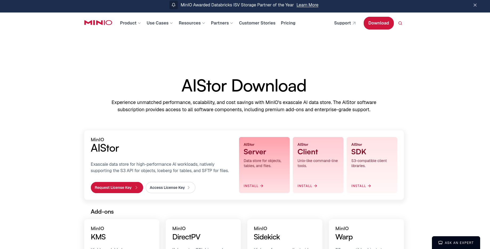
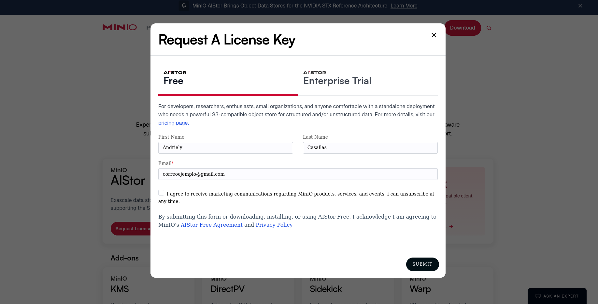
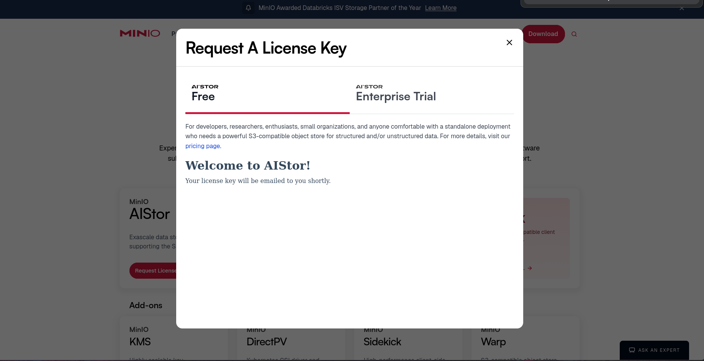
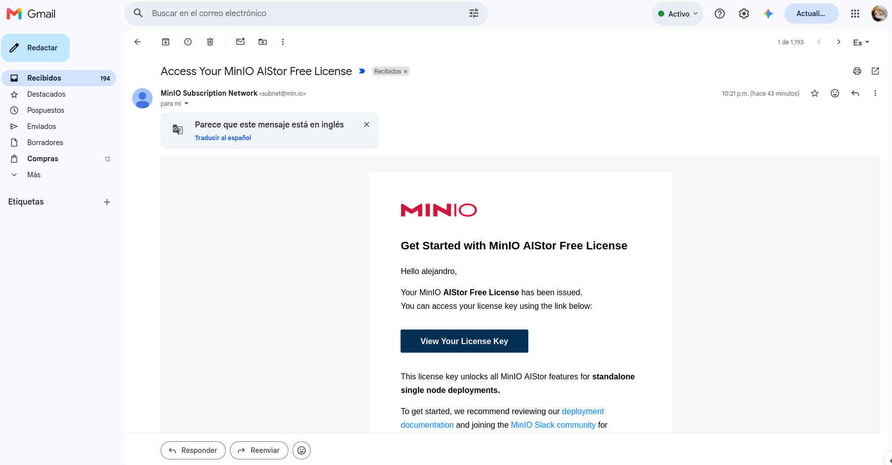
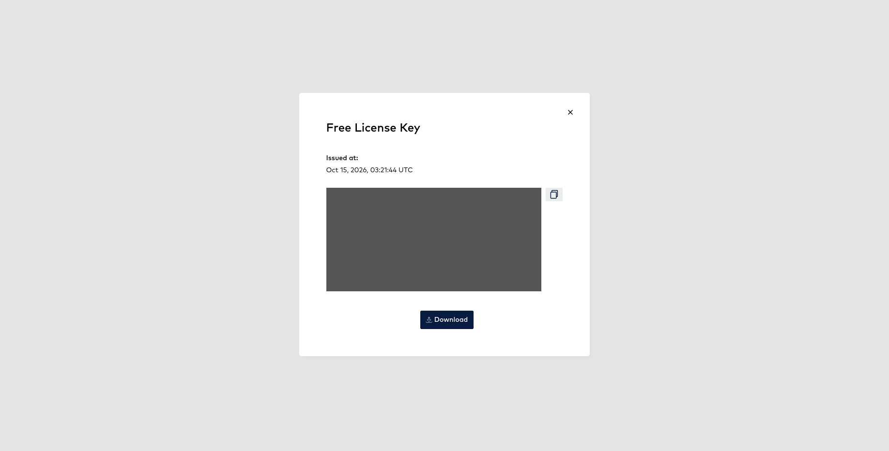
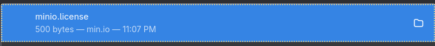
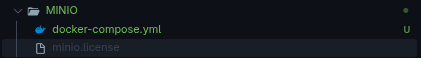

<div align="center">
  

  # Laboratorio S3 local

  Guías para ejecutar **FLOCI** y **MinIO AIStor** localmente con Docker.


  [](https://www.docker.com/)
  [](https://min.io/)
  [](https://www.python.org/)
  [](#licenciamiento)
</div>

---

## ¿Qué incluye este repositorio?

- **FLOCI**: API S3 local en `http://localhost:4566` y una interfaz web en `http://localhost:8080`.
- **MinIO AIStor**: API S3 en `http://localhost:9000` y consola en `http://localhost:9001`.
- **Pruebas de integración** en Python 3.12 con `boto3`.
- Espacios preparados para capturas de las interfaces y documentación complementaria.

## Requisitos rápidos

1. Docker Desktop (Windows o macOS) o Docker Engine + Compose (Linux).
2. Python 3.12 para ejecutar las pruebas.
3. Una licencia válida de MinIO AIStor en `MINIO/minio.license` si se va a levantar MinIO AIStor.

> Los comandos de esta guía se ejecutan desde la carpeta raíz `floci_docs`.

## Documentación

- [Instalación y ejecución en Windows, Linux y macOS](docs/SETUP.md)
- [Pruebas de integración](docs/TESTING.md)
- [Solución de problemas](docs/TROUBLESHOOTING.md)
- [Capturas saneadas de MinIO AIStor](docs/assets/screenshots/minio/README.md)

## Referencias oficiales de MinIO

El punto de partida para descargar MinIO AIStor, el cliente y obtener la licencia es
la página oficial de [descargas de MinIO](https://www.min.io/download). La guía oficial
para ejecutar AIStor en un contenedor está disponible en la
[documentación de instalación con Docker](https://docs.min.io/aistor/installation/container/install/).

En este repositorio, las capturas de la consola y de las operaciones S3 están guardadas
en [`docs/assets/screenshots/minio/`](docs/assets/screenshots/minio/). La licencia y los
datos locales de MinIO no deben publicarse ni incluirse en commits.

### Capturas de MinIO AIStor

| Descarga de AIStor | Solicitud de licencia |
|---|---|
|  |  |

| Confirmación de licencia | Correo de licencia |
|---|---|
|  |  |

| Clave de licencia | Archivo local de licencia |
|---|---|
|  |  |

| Carpeta local de MinIO |
|---|
|  |

## Inicio rápido

```bash
cd FLOCI
docker compose up -d
```

Comprueba FLOCI en `http://localhost:4566` y su interfaz web en `http://localhost:8080`.
Para detenerlo:

```bash
docker compose down
```

## Licencia y secretos

No se deben subir credenciales reales, archivos `.license`, datos de MinIO ni carpetas `.venv`.
Las credenciales mostradas en los ejemplos son únicamente las credenciales locales definidas
por los archivos Compose.
